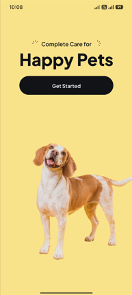
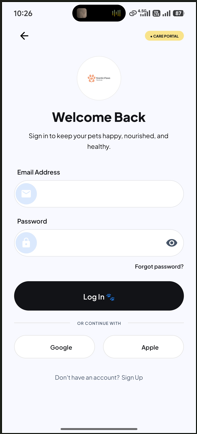
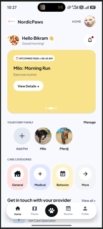
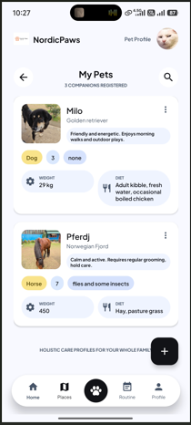
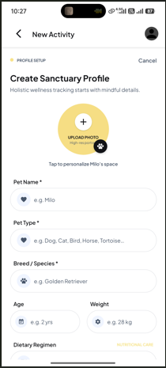
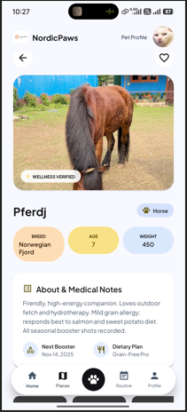
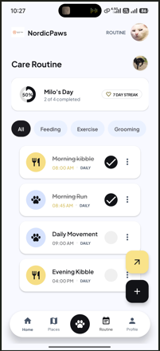
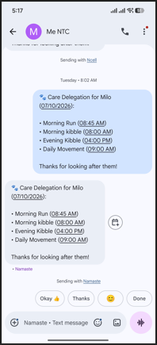
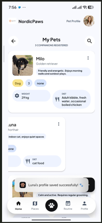
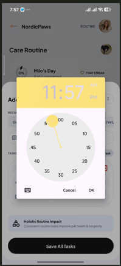

# Nordic Paws

---

## Demo Overview (Screenshots)

<div style="display: flex; flex-wrap: wrap; gap: 10px; justify-content: center;">
  
  
  
  
  
  
  
  
  
  
</div>

> Replace the placeholder images above with the actual screenshots placed under `images/`.

---

## Project Description

**Nordic Paws** is a premium, cloud‑synced pet‑management Android application built with Java and Android Studio. It serves as a single, comprehensive hub for pet owners to **organize daily pet‑care routines**, manage detailed pet profiles, and keep everything **securely synchronized** across devices via Firebase.

The app tackles several common problems for pet owners:
- **Cognitive overload**: By centralizing feeding, exercise, medication, and grooming schedules, owners no longer need to remember disparate tasks.
- **Data fragmentation**: All pet information (profiles, images, routine tasks) lives in a unified Firestore schema, eliminating scattered notes or spreadsheets.
- **Offline latency**: Images are cached locally through `LocalStorageManager`, providing instant loading and offline access while reducing cloud storage costs.
- **Usability friction**: Bottom‑sheet dialogs retain context when editing data, and a **shake‑to‑reset** gesture speeds up form entry.
- **Inconsistent UI**: Material‑3 design, Lottie animations, and custom theming give a polished, cohesive visual experience.

---

## Features & Problem‑Solving Details

| Feature | How It Solves a Problem |
|---|---|
| **Multi‑Pet Management** | Stores detailed profiles (name, breed, age, custom tags, avatar) for each pet, avoiding the need for multiple separate apps or manual records. |
| **Routine Scheduler** | Allows creation of daily/weekly tasks (feeding, walks, meds) with push notifications, reducing missed appointments and forgotten duties. |
| **Firebase Sync** | Real‑time Firestore synchronization keeps data consistent across phones and tablets, eliminating manual backups. |
| **Local Image Caching (`LocalStorageManager`)** | Saves avatars as compressed JPEGs in internal storage, offering instant UI rendering and offline capability while cutting down on Cloud Storage bandwidth. |
| **Bottom Sheet UX** | Editing screens appear as modal bottom sheets, preserving the underlying context and preventing disruptive activity switches. |
| **Shake‑to‑Reset** | Detects a device shake to instantly clear the add‑pet form, speeding up data entry for power users. |
| **Material 3 & Custom Theming** | Enforces a consistent color palette and typography, providing an aesthetically pleasing and accessible UI. |
| **Lottie Animations** | Uses vector‑based animations for splash screens and transitions, delivering buttery‑smooth visual feedback without large asset sizes. |
| **Secure Authentication** | Firebase Authentication safeguards user data and simplifies login/registration flows. |
| **RecyclerView Adapters** (`PetProfileAdapter`, `RoutineTaskAdapter`, etc.) | Efficiently renders large lists with view recycling, reducing memory usage and improving scroll performance. |
| **Cascading Delete (`FirestoreManager`)** | Guarantees that when a pet is removed, all its associated routine tasks are also deleted, preventing orphaned data. |
| **Hardware Interaction** | Uses accelerometer to detect shake gestures, showcasing extensibility for future sensor‑based features. |
| **Comprehensive Architecture** | Clear separation of concerns: data models, managers, UI fragments, and adapters are modular, making the codebase maintainable and extensible. |

---

## Architecture Overview (Brief)

- **Data Models**: `User`, `Pet`, `RoutineTask` represented as Java POJOs and stored in Firestore with hierarchical sub‑collections.
- **Managers**: `FirestoreManager` encapsulates all database operations; `LocalStorageManager` handles image persistence.
- **UI Layer**: Single‑Activity architecture with `BottomNavigationView` switching between Fragments (`HomeFragment`, `PetProfileListFragment`, `RoutineFragment`, `ProfileFragment`).
- **Animations**: Lottie for splash, custom XML transitions for activity changes, and elevation tricks for modern depth perception.
- **Utilities**: Sensor‑based shake detection, bottom‑sheet dialogs, and RecyclerView adapters for performant list rendering.

---

## Screenshots

> Screenshots of the app.


---

## Getting Started

1. **Clone the repository**
   ```bash
   git clone https://github.com/yourusername/NordicPaws.git
   ```
2. **Open in Android Studio**
   - Choose **File → Open** and select the project root.
3. **Configure Firebase**
   - Create a Firebase project.
   - Download `google-services.json` and place it in `app/`.
   - Enable **Authentication** (Email/Password) and **Firestore**.
4. **Run the app** on an emulator or physical device.

---

## Contributing

Contributions are welcome! Please:
- Fork the repo and create a feature branch.
- Follow the existing coding style (Java, AndroidX, Material 3).
- Submit a Pull Request with a clear description of the change.

---

## License

This project is licensed under the **MIT License** – see the `LICENSE` file for details.

---

*For an in‑depth technical reference, see the accompanying [system.md](system.md) document.*
